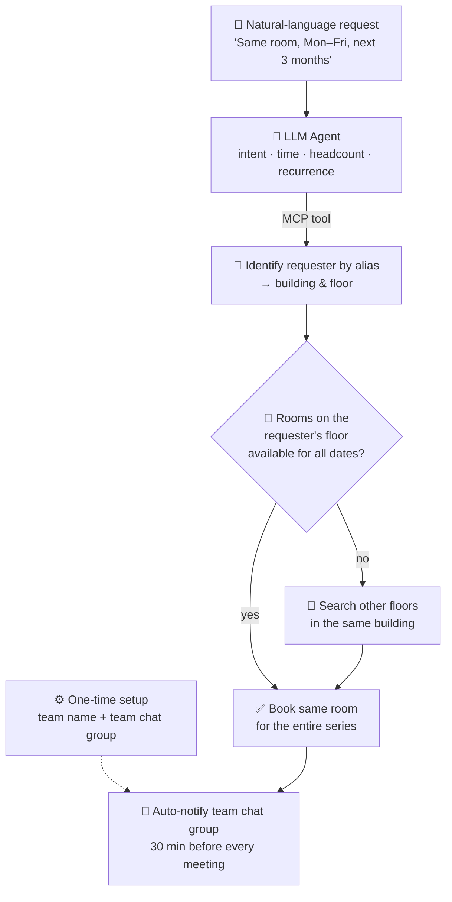

<div align="center">

# Dheeraj Pavuluri

**Software Development Engineer · Amazon (Fire TV Platform)**<br>
Backend · Distributed Systems · Cloud (AWS) · Full-Stack · Platform Engineering

[](https://www.linkedin.com/in/dheeraj-pavuluri/)
[](mailto:dheerajreads@gmail.com)
[](#)

</div>

---

## About

> **Building reliable systems at scale**: from APIs and event-driven pipelines to the platforms engineers ship on.

```yaml
engineer:
  name:       Dheeraj Pavuluri
  role:       Software Development Engineer @ Amazon (Fire TV Platform)
  education:  M.S. Computer Science, New York University
  location:   San Francisco Bay Area

  domains:
    backend:        REST APIs · microservices · JWT/RBAC auth · SQL & NoSQL
    distributed:    event-driven pipelines · SQS · EventBridge · retries & DLQs
    cloud:          AWS Lambda · ECS Fargate · API Gateway · S3 · DynamoDB · Terraform
    full_stack:     React · Node.js · TypeScript · PostgreSQL
    platform:       CI/CD · test infrastructure · developer productivity
    observability:  SLOs · CloudWatch · Grafana · Prometheus · OpenTelemetry
    ai:             LLM agents · tool calling · MCP · RAG

  impact:
    - "Unified 3 automation frameworks into 1 platform for 20+ teams (U.S. & Europe)"
    - "Cut test execution from 15 min to under 2 min (-87%)"
    - "Streamed 1M+ CI/CD events through a serverless, event-driven pipeline"
    - "Improved incident response by 30% with SLO monitoring and failure detection"
    - "Reduced API and SQL latency by 40%"

  currently:  building LLM agents with tool calling and MCP
  open_to:    [Backend, Distributed Systems, Cloud, Full-Stack, Platform]
```

### How I build

| **Design for failure** | **Measure everything** | **Make the fast path the easy path** |
|:---|:---|:---|
| Async workflows, retries and dead-letter queues, so one failure never takes down the whole system. | SLOs, dashboards and tracing turn "it feels slow" into a number someone can fix. | Platforms and automation that let teams ship faster without cutting corners. |

## Tech Stack

**Languages**


**Distributed Systems**


**Cloud & Infrastructure**


**Data, Web & Observability**


**Testing & AI**


## Featured Projects

### 🎧 [TicketPilot: AI Support Agent](https://github.com/Dheerajpavuluri/ticketpilot)
*Personal project · LLM agents · FastAPI · React · 2026*<br>
An AI support agent that works a real ticket queue: it looks up customers and orders, searches the help center, opens refunds within policy and drafts replies that cite their sources. Deterministic guardrails route safety issues, legal threats, large refunds and low-confidence answers to a human review console with a full agent trace. Provider-agnostic (OpenAI / Anthropic tool calling), scored by an eval suite that gates CI on **zero unsafe auto-replies**, and scales out on taskforge workers.<br>
`LLM Agents` `Tool Calling` `Evals` `Python` `FastAPI` `React` `TypeScript` `PostgreSQL` `Redis` `Docker`

---

### 🤖 AI Meeting Room Scheduler: Agentic Booking Assistant
*Side project at Amazon · LLM agent · Tool calling · Model Context Protocol (MCP) · 2026*

Built as a **side project at Amazon** to take the friction out of booking meeting rooms for teams. It's an **agentic AI assistant** that turns plain-English requests like *"Book the same room for my team, Monday to Friday at 10 AM, for the next 3 months"* into confirmed meeting-room reservations, with no forms and no calendar hunting.

**How it works**

1. **One-time setup:** the user registers their **team name and team chat group**, so every meeting the agent books is tied to the right team.
2. **Knows who's asking:** the agent identifies the requester from their **alias** and looks up their **office building and floor**.
3. **Understands the request:** it extracts time, duration, headcount and **recurrence**, from a single meeting to long-running series like *"same room, Mon–Fri, for 3 months"*.
4. **Location-aware room search:** it searches the requester's **own floor first**, then falls back to other floors in the building, matching capacity and checking availability **across every date in the series**.
5. **Books the series:** it reserves the **same room for the whole recurrence**, so the team isn't moved around day to day.
6. **Keeps the team on time:** **30 minutes before** each meeting, it sends a notification to the team's chat group automatically.



**What makes it more than a chatbot**

- **Agentic tool use:** the model doesn't just answer; it acts, chaining tool calls (identity lookup, room search, availability, booking, notifications) to finish a real task end to end.
- **MCP integrations:** tools are exposed through the Model Context Protocol, so new data sources and actions plug in without rewriting the agent.
- **Personalized by default:** the requester's alias, building and floor drive every decision, so the nearest suitable room comes first.
- **Long-range recurring bookings:** one request can lock the same room for weeks or months of weekday meetings.
- **Team-aware notifications:** reminders go to the team's chat group automatically, 30 minutes before every meeting.

`LLM Agents` `Tool Calling` `MCP` `Natural Language Understanding` `Recurring Scheduling` `Chat Notifications` `Workflow Automation`

---

### [taskforge: Distributed Task Queue](https://github.com/Dheerajpavuluri/taskforge)
*Personal project · Python · Redis · FastAPI · 2026*<br>
A distributed task queue on Redis, like a mini SQS or Celery. Workers claim tasks atomically through Lua scripts, leases with heartbeats recover work from crashed workers, and failed tasks retry with exponential backoff and jitter before landing in a dead-letter queue. It also supports priorities, delayed tasks, idempotency keys, graceful shutdown and Prometheus metrics. Benchmarked at ~3,400 tasks/s on 2 vCPUs, with **zero tasks lost** when a worker was killed mid-run.<br>
`Python` `Redis` `Lua` `FastAPI` `asyncio` `Prometheus` `Docker` `GitHub Actions`

### Swipply: Distributed Job Matching Platform
*NYU, 2024*<br>
Swipe-style job matching with Python/Java recommendation services behind REST APIs. Asynchronous processing on SQS with retries and dead-letter queues, JWT auth, IAM and throttling, CI/CD on GitHub Actions, and tracing with CloudWatch and X-Ray.<br>
`React` `AWS Lambda` `ECS Fargate` `SQS` `DynamoDB` `API Gateway`

### Serverless Dining Concierge Chatbot
*NYU, 2024*<br>
Event-driven chatbot that collects dining preferences in conversation, queues requests and emails personalized restaurant suggestions, with persistent user state and search.<br>
`Amazon Lex` `Lambda` `SQS` `DynamoDB` `OpenSearch` `SES` `S3`

### [Technical Support Centre Simulation](https://github.com/Dheerajpavuluri/Technical-Support-Centre)
*C++ simulation*<br>
Monte Carlo, discrete-event simulation of a three-agent support queue, reporting waiting time, turnaround time and agent utilization.<br>
`C++` `Simulation` `Queueing theory`

## Experience

| Role | Company | Dates |
|---|---|---|
| Software Development Engineer, Fire TV Platform | Amazon | 2025 – Present |
| Cloud Security Analyst | Technical Consulting and Research, Inc. | 2024 – 2025 |
| Full Stack Developer | Winfra Technical Consultants | 2021 – 2022 |
| Full Stack Developer | Marmag Infra | 2020 – 2021 |

## Education

**New York University**, M.S. in Computer Science (2023 – 2025)

---

<div align="center">
<sub>Open to software engineering opportunities in backend, distributed systems, platform, infrastructure and developer tools.</sub>
</div>
